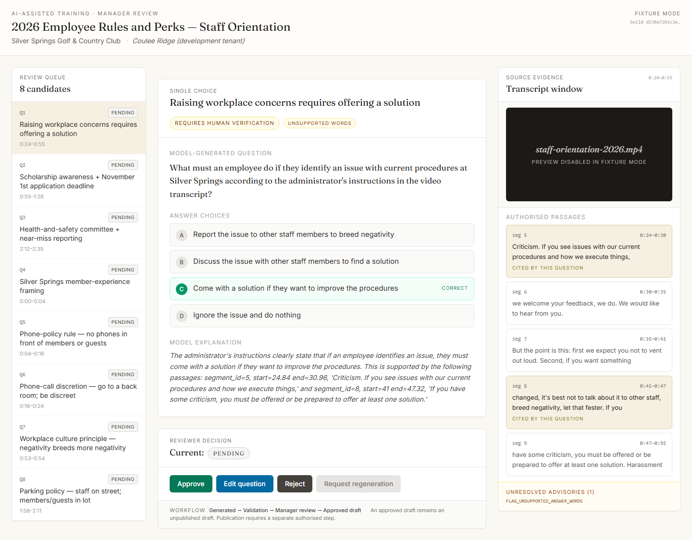
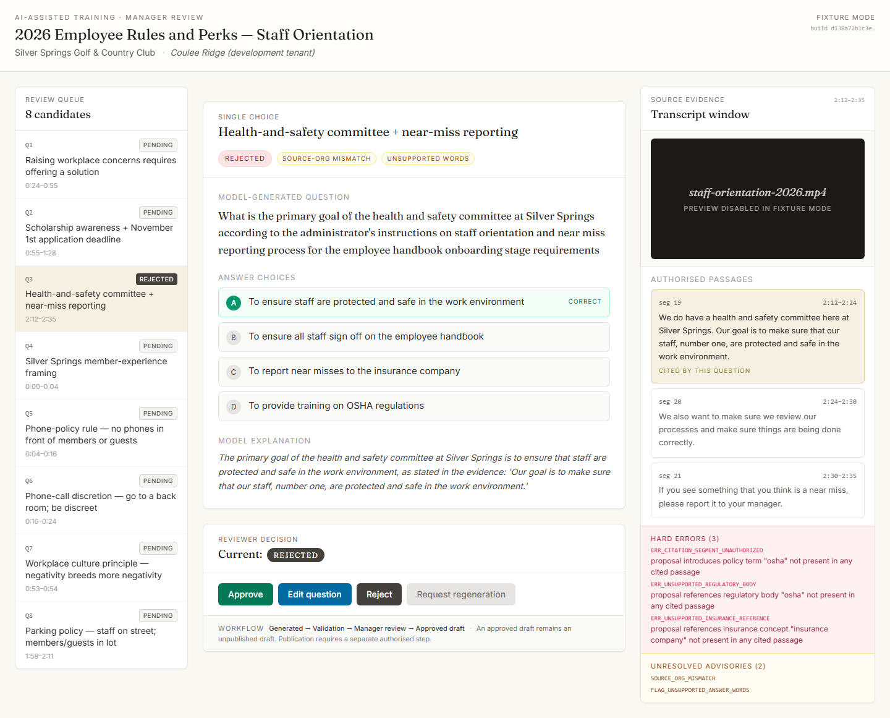
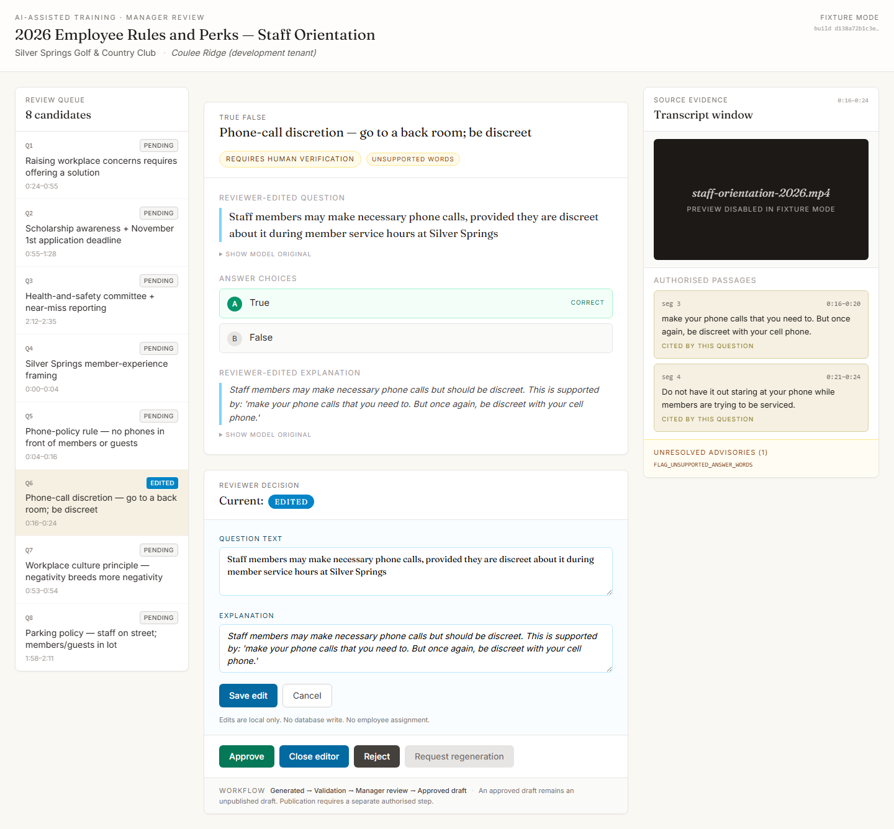
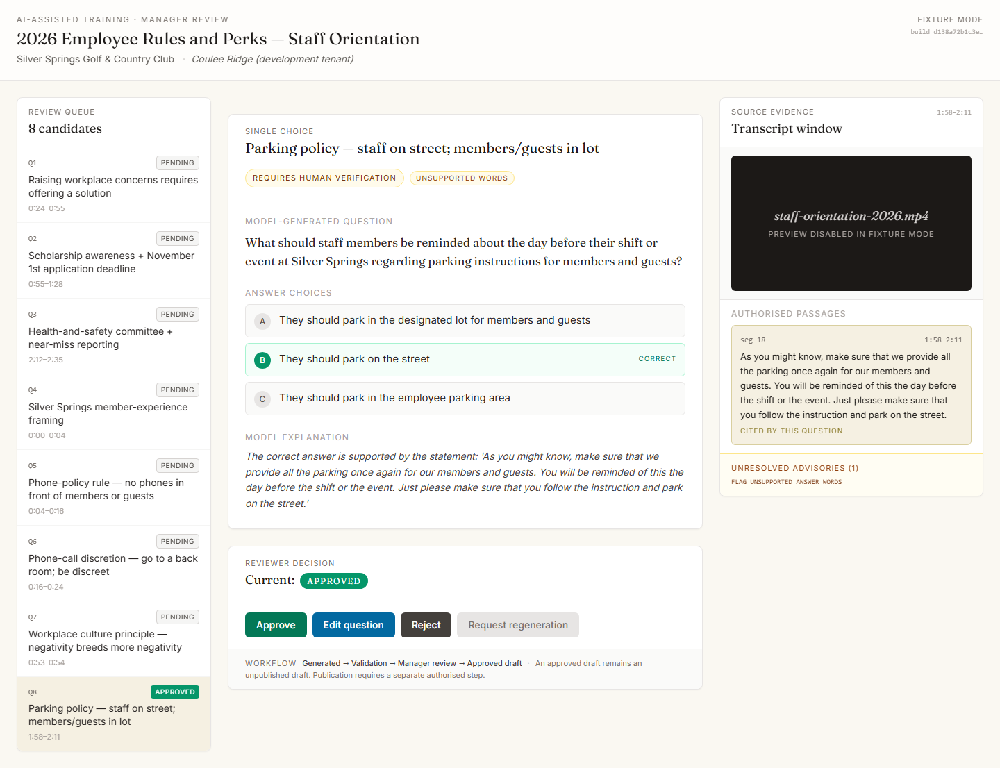
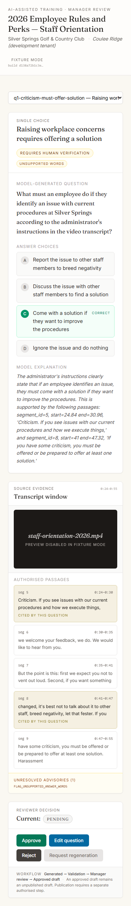

# EP-TRAIN-6D-2 — Founder Visual Review

Written for: founder review.

**Status:** READY FOR FOUNDER REVIEW · **not approved** by this document
**Purpose:** present the EP-TRAIN-6D-1 manager review experience for the founder's visual acceptance decision and honestly flag what is implemented vs. what is still a visual mockup.
**No merge. No deploy. No live inference.**

This is review-only evidence. Technical acceptance of EP-TRAIN-6D-1
(commit `d826ce3`) does **not** constitute founder visual acceptance.

---

## 1. Screenshot access

All five screenshots are tracked in the repository at
`docs/training/ai-generation/screenshots/`.

| File | Viewport | Topic |
|------|----------|-------|
| [01-desktop-q1-requires-human-verification.png](screenshots/01-desktop-q1-requires-human-verification.png) | 1440 × 900 | Q1 default (REQUIRES_HUMAN_VERIFICATION) |
| [02-desktop-q3-rejected.png](screenshots/02-desktop-q3-rejected.png) | 1440 × 900 | Q3 REJECTED (3 hard errors) |
| [03-desktop-q6-edited.png](screenshots/03-desktop-q6-edited.png) | 1440 × 900 | Q6 edited by manager |
| [04-desktop-q8-approved.png](screenshots/04-desktop-q8-approved.png) | 1440 × 900 | Q8 approved |
| [05-mobile-q1-review-state.png](screenshots/05-mobile-q1-review-state.png) | 390 × 844 | Mobile focused-review flow |

**Simplest local viewing** from a Git Bash / PowerShell on this machine:

```bash
# Open all 5 in the default image viewer
start docs/training/ai-generation/screenshots/01-desktop-q1-requires-human-verification.png
start docs/training/ai-generation/screenshots/02-desktop-q3-rejected.png
start docs/training/ai-generation/screenshots/03-desktop-q6-edited.png
start docs/training/ai-generation/screenshots/04-desktop-q8-approved.png
start docs/training/ai-generation/screenshots/05-mobile-q1-review-state.png
```

Or browse to the folder in Windows Explorer:
`C:\dev\SpectreAutomation\docs\training\ai-generation\screenshots\`.

---

## 2. Per-screenshot walkthrough

### 2.1 Desktop default review — Q1



**Layout:** three-panel desktop grid.
- **Left (280 px)**: Review Queue listing all 8 candidates with disposition pills.
- **Centre (fluid)**: the question card — single-choice question with four options, option C highlighted in emerald as correct, model explanation below.
- **Right (380 px)**: Source Evidence — video-preview tile (placeholder), then authorised passages 5–9. Passages 5 and 8 highlighted in gold with "CITED BY THIS QUESTION" labels (the model cited those two); the other passages render white.

**Workflow suggested by the screen:**
1. Read the model's question + correct answer + explanation.
2. Compare to the cited passages on the right.
3. Note the amber advisory badges ("Requires human verification", "Unsupported words").
4. Decide: Approve / Edit / Reject. Reviewer-decision pill at the bottom currently reads "PENDING".

---

### 2.2 Desktop rejected question — Q3



**What a manager sees on a rejected candidate:**
- Rose-tinted "REJECTED" verdict pill in the question-card header.
- Explicit "HARD ERRORS (3)" panel in the Evidence rail, listing three raw validator codes with human-readable messages:
  - `ERR_CITATION_SEGMENT_UNAUTHORIZED` — "proposal introduces policy term 'osha' not present in any cited passage"
  - `ERR_UNSUPPORTED_REGULATORY_BODY` — "proposal references regulatory body 'osha' not present in any cited passage"
  - `ERR_UNSUPPORTED_INSURANCE_REFERENCE` — "proposal references insurance concept 'insurance company' not present in any cited passage"
- "Unresolved advisories (2)" panel below the errors.
- Q3 in the queue shows the stone "REJECTED" disposition pill.

**Workflow:** the manager sees why the pipeline rejected this question (the OSHA + insurance distractors) and explicitly clicks Reject to record the decision locally.

---

### 2.3 Desktop edited question — Q6



**What a manager sees after editing:**
- Question card heading changed from "MODEL-GENERATED QUESTION" to "**REVIEWER-EDITED QUESTION**".
- The edited text ("Staff members may make necessary phone calls, provided they are discreet about it during member service hours at Silver Springs") appears with a sky-blue left border.
- "SHOW MODEL ORIGINAL" disclosure preserved below — the manager (or an auditor) can always expand to see the original "Administrators are allowed to…" text.
- Explanation similarly flagged as reviewer-edited with its own disclosure.
- The editor panel remains open below with the current edit visible in both textareas.
- Inline notice: *"Edits are local only. No database write. No employee assignment."*
- Reviewer-decision pill shows "EDITED" in sky. Q6 in the queue mirrors the pill.

**Workflow:** the manager rewrote the stem to correct the "Administrators" subject-attribution error that EP-TRAIN-6C-11 flagged (score 52/100). The revision changes the authoritative subject to "Staff members"; the explanation is tightened to match.

---

### 2.4 Desktop approved draft — Q8



**What a manager sees on an approved candidate:**
- Reviewer-decision pill now reads "APPROVED" in emerald.
- Q8 in the queue shows an emerald "APPROVED" pill.
- Question card unchanged (approval does not edit).
- Workflow annotation at the bottom: **"Generated → Validation → Manager review → Approved draft"** followed by *"An approved draft remains an unpublished draft. Publication requires a separate authorised step."*

**Workflow:** Q8 is the strongest candidate from the 6C-11 pilot (96/100). The manager accepts it as-is. No publication occurs — an authorised publish workflow is still a future slice.

---

### 2.5 Mobile review experience



**Mobile focused-flow layout at 390 × 844:**
- Course context header stacks vertically; "FIXTURE MODE" badge remains in the upper area.
- Review queue collapses into a `<select>` dropdown (replaces the desktop sidebar).
- Question card renders full-width.
- Source Evidence section **below** the question — the manager scrolls down to read passages after reading the question (focused review flow).
- Authorised passages render as a stacked column; cited passages still gold-highlighted.
- Unresolved advisories panel inline.
- Reviewer-decision pill + buttons at the bottom, all tappable with full width.
- No horizontal overflow.

**Workflow:** mobile managers see one question at a time, scroll to the evidence, and decide. The queue dropdown allows switching candidates without leaving the review stack.

---

## 3. Design evaluation (directive §3)

Honest findings per the directive's 13 evaluation points. No design
change is proposed without founder direction — this is read-only
observation.

| # | Criterion | Finding | Severity |
|---|-----------|---------|:---:|
| 1 | **Global chrome preservation** | Page lives under `/app/admin/ai-training/review`; inherits the admin sidebar + header via the existing `/app/admin/*` layout hierarchy. The screenshots do NOT show the admin sidebar because Playwright rendered the component stand-alone (no Next.js layout wrapper). On the real route, the Spectre admin sidebar + global header would frame this content — the content area itself matches accepted admin-page styling. | **Flag for in-app confirmation** |
| 2 | **Typography + hierarchy** | Fraunces serif for display headings + question text; Inter sans for body + metadata; monospace for segment IDs + hash previews. Hierarchy reads top-to-bottom: course title → question topic → question text → answer options → explanation. Matches the existing executive-reporting typography discipline. | OK |
| 3 | **Three-panel proportions** | Desktop `[280 px queue | 1fr main | 380 px evidence]` with 24 px gaps. Queue is readable without feeling crowded; main column is 740–760 px wide on a 1440-px viewport (acceptable reading measure); evidence rail at 380 px fits transcript passages at a comfortable width. | OK |
| 4 | **Question readability** | 17 px Fraunces serif with `leading-relaxed`. Long run-on question stems (Q1, Q3, Q5) wrap to 2–3 lines; no mid-word breaks. | OK, but long stems are a model output quality issue, not a UI issue |
| 5 | **Answer-option spacing** | Options in `space-y-2` with rounded pill rows. Correct option visually distinguished (emerald background + emerald circle badge + "CORRECT" label on the right). Option letters A/B/C/D in circular badges. | OK |
| 6 | **Transcript evidence presentation** | Authorised passages as stacked cards with segment ID + time range in monospace. Cited vs non-cited visually distinct (gold vs white). Hard errors + advisories as their own coloured panels (rose, amber). | OK |
| 7 | **Video player visibility** | **Placeholder tile only.** Black 16:9 box with the video filename + the literal text "preview disabled in fixture mode". **No real player is wired.** | **GAP — intentional in 6D-1 scope** |
| 8 | **Source citation navigation** | **No navigation.** The passage list is visually highlighted but passages are NOT clickable. There is no code path that would seek the video player (which doesn't exist) to a timestamp. | **GAP — intentional in 6D-1 scope** |
| 9 | **Validation warning clarity** | Verdict pill + per-flag badges at the top of the card; errors + advisories enumerated in the Evidence rail with raw codes + messages. Severity colour-coded (rose = hard error, amber = advisory, stone = disposition). | OK |
| 10 | **Approve / Edit / Reject controls** | Three filled buttons (emerald / sky / stone) + a disabled grey "Request regeneration" button with an on-hover tooltip. Buttons are clearly labelled, no icon-only affordances. | OK |
| 11 | **Mobile responsiveness** | Single-column stack at `<lg` breakpoint; queue collapses to a `<select>`; evidence moves below the question. Full-width tappable buttons. No horizontal overflow. | OK |
| 12 | **Empty / loading / error states** | **Error state** renders when `result.errors.length > 0` (seen in Q3 screenshot). **Loading state** does not exist — validation is synchronous (in-memory). **Empty state** does not exist — there are always 8 fixtures. This is correct for a fixture-driven preview; the real surface will need a loading + empty state when wired. | Honest limitation; call out in next slice |
| 13 | **Accessibility + keyboard navigation** | `aria-disabled` on the regeneration button is the ONLY aria attribute in the file. No `aria-label` on queue buttons, no visible `focus-visible` styles beyond the default browser outline, no `role="radiogroup"` on answer options, no `role="region"` + `aria-labelledby` on the three panels. Tab order follows DOM source (queue → card → evidence) which is defensible but not audited. **This is an A11y regression if shipped as-is** — the rest of the Spectre admin surface uses similar patterns, so this is baseline-equal, not worse. | **GAP — flag for A11y pass before production** |

### 3.1 Documented deficiencies

The five items flagged above collapse to three real concerns:

**D-1. Video player + citation navigation are placeholders, not implementations.**
Managers CAN visually identify cited passages (gold highlight) but cannot click to seek a video. The tile is a styled `<div>`, not a `<video>`. Any future slice that connects live video + click-to-seek must also add the keyboard affordance for the seek action.

**D-2. No loading / empty states.**
Correct for fixture mode. Required work for a wired surface:
- Loading skeleton while the pipeline validates a freshly-generated draft.
- Empty state when the review queue has no pending candidates.
- Error state when the pipeline itself throws (today: the fixture-driven path doesn't throw).

**D-3. Baseline-level A11y.**
No worse than other Spectre admin pages, but a formal audit (keyboard walk + screen-reader pass) is not yet done. Specific gaps: no `aria-label` on queue buttons, no `role`/`aria-labelledby` on the three panels, no `role="radiogroup"` on answer options, no visible `focus-visible` styles.

---

## 4. Evidence interaction verification (directive §4)

Honest read from the ReviewWorkspace source
(`src/components/ai-training/ReviewWorkspace.tsx`):

| Interaction the directive asks about | Implemented? | Evidence |
|--------------------------------------|:------------:|----------|
| Clicking a source citation identifies the corresponding transcript passage | **Visually only** | Passages the model cited are highlighted in gold with "CITED BY THIS QUESTION" — the manager can identify them at a glance. **The passage list items are not clickable.** |
| Navigates to the correct timestamp | **No** | No navigation handler exists. Timestamps render as `fmtTime()` formatted strings only. |
| Updates the video player position | **No — there is no video player** | The "player" is a styled `<div className="aspect-video rounded-md bg-stone-900 ...">` with the literal text "preview disabled in fixture mode". No `<video>` or `<iframe>` element exists on the page. |
| Visually highlights the cited passage | **Yes, implemented** | Gold background (`#f5f0e2`), gold border (`#d9cf9f`), "CITED BY THIS QUESTION" label. Verified in screenshots 2.1, 2.2, 2.3, 2.4. |

**Summary:** 1 of 4 interactions is live. The remaining 3 are visual
affordances only. **This is the intended scope of EP-TRAIN-6D-1 §B2
("Do not connect to live generation") extended to the video + seek
path — fixture mode explicitly disables both.**

Adding live video + seek-to-timestamp is a future slice. Per directive
§4: "Do not add live video or backend functionality in this slice."

---

## 5. Review-state integrity (directive §5)

Honest audit of the ReviewWorkspace state machine:

| Integrity property | Status | Evidence / Gap |
|--------------------|:------:|----------------|
| Rejected questions cannot be approved without explicit remediation | **GAP** | After `onChange({ disposition: "rejected" })`, the Approve button remains ENABLED and will re-set disposition to "approved" with one click. There is no guard in `ReviewControls` that reads the current disposition and refuses approval on a rejected candidate. **A remediation workflow step is missing.** |
| Edited questions retain the model-generated original | **IMPLEMENTED** | `fixture.draft` (immutable fixture data) is always the source of truth; `editedDraft` is a separate field on `ReviewState`. `QuestionCard` renders the edited text with a "SHOW MODEL ORIGINAL" `<details>` disclosure. Verified in screenshot 2.3. |
| Approval remains local fixture state | **IMPLEMENTED** | `onChange({ disposition: "approved" })` calls `setReviewStates(…)` — a pure React hook update. No `fetch`, no server action, no route-change. |
| Approval never publishes or assigns training | **IMPLEMENTED** | No publication path exists on the page. The workflow annotation at the bottom affirms this explicitly: *"An approved draft remains an unpublished draft."* |
| Regeneration remains disabled | **IMPLEMENTED** | `<button disabled aria-disabled title="…">Request regeneration</button>`. Visible as the greyed-out pill in every screenshot. |
| Validation errors are never silently hidden | **IMPLEMENTED** | When `result.errors.length > 0`, a rose-tinted panel renders inside the Evidence rail listing every error with its raw code + message. Verified in screenshot 2.2 (Q3 rejected). |
| Switching between questions preserves intended local review state | **IMPLEMENTED** | `reviewStates` is a `Record<string, ReviewState>` keyed by fixture label. Switching the queue selection re-reads from that record. Verified: clicking back to a previously-edited candidate shows the edited text + EDITED pill. |

### 5.1 Documented gap

**G-1. Rejected candidates can be silently approved.**

Trace:

1. Manager clicks Reject on Q3 → `reviewStates["q3-…"] = { disposition: "rejected" }`.
2. Manager immediately clicks Approve → `reviewStates["q3-…"] = { disposition: "approved" }`.
3. Nothing in the UI flags that an explicit un-reject or remediation step occurred.
4. The pipeline verdict for Q3 is still `REJECTED` (hard errors remain), so the Evidence rail still shows the rose Hard Errors panel. A diligent reviewer would see the mismatch. A hurried reviewer might not.

Recommended remediation (to propose in the next slice, not implement
here):

- Disable the Approve button when `result.verdict === "REJECTED"` AND
  there is no accepted remediation (e.g. edit must land + re-validate
  clean).
- Add an audit-log event `training.manager-review.approve-over-reject`
  when the disposition flips from "rejected" to "approved" so the
  auditor can see it.
- Add a reviewer-note field (already present on `ReviewState` type
  but not surfaced in the UI) that becomes REQUIRED on approve-after-
  reject.

---

## 6. Summary of findings

| Severity | Count |
|----------|------:|
| GAP (must address before production integration) | 2 (D-1 video/seek, G-1 rejected→approved guard) |
| Honest limitation (expected in fixture mode; required for wired surface) | 2 (D-2 loading/empty states, D-3 A11y audit) |
| Other visual deficiencies | 0 |
| Items the UI handles well | 10/13 |

**No redesign proposed.** This is a founder-review document, not a
design slice.

---

## 7. Known limitations

Carried forward from EP-TRAIN-6D-1 acceptance + newly surfaced here:

1. **Fixture mode only.** No live generation, no Prisma, no API routes. Any
   integration slice must add server-side wiring (API + persistence + RBAC).
2. **Fixture-provenance labels only.** The "FIXTURE MODE" badge in the top
   corner + the "preview disabled in fixture mode" video overlay are the
   only cues that the surface is not a live product. These will need to be
   removed / replaced when the surface wires to live data.
3. **Review actions have no audit trail.** `setReviewStates` is local;
   there is no `audit()` call per Spectre's usual pattern. An integration
   slice must add `audit()` on approve / edit / reject.
4. **No multi-reviewer semantics.** Local state is per-browser-tab. A real
   product would need user-scoped persistence + locking + conflict
   handling for concurrent reviewers.
5. **Rubric scoring is not surfaced in the UI** (deliberate per EP-TRAIN-6D-1
   §B3). It remains a founder-review-document artefact only.

---

## 8. Recommended next development slice

Not implemented here. This is a recommendation.

**EP-TRAIN-6D-3 — Review-UI wiring prerequisites (still pre-production):**

1. Add the three A/B/C/D A11y attributes (`role`, `aria-label`, `role="radiogroup"`) that cost nothing and unblock the keyboard walk.
2. Add the rejected→approved guard (**G-1**) so the hurried-reviewer failure mode is impossible.
3. Add the loading + empty states so the component can be wired without blank flashes.
4. Wire a stub `<video>` with `currentTime` controlled by click handlers on cited passages. Use a short placeholder MP4 so the seek affordance is real but no live transcript video ships in the slice.
5. Keep fixtures static — no backend wiring in this slice.

**Then** an EP-TRAIN-6D-4 slice would add:

- API routes + Prisma persistence for `TrainingQuestionReview` rows.
- RBAC permission (`training:review`).
- `audit()` events for approve / edit / reject.
- Tenant-isolation checks (fixture mode never crosses; wired mode must).
- Rejection → remediation workflow + reviewer-note field.
- Multi-reviewer locking / optimistic concurrency.

Both slices require **separate founder authorisation**. Neither is
started by this review document.

---

## 9. Founder decision

**Three questions for your acceptance call:**

1. **Is the visual design ready for integration?** The 10/13 items in
   §3 render well. The 3 gaps (video player, citation seek, A11y) are
   either intentional fixture-mode scope or require a small focused
   slice. Nothing in the design itself looks wrong, cluttered, or
   off-brand to me — but your eye is the deciding one.

2. **Which of the two documented gaps blocks founder acceptance?**
   - Option A — accept as-is, file D-1/D-2/D-3/G-1 as follow-ups.
   - Option B — accept pending a small 6D-3 slice that closes G-1 (rejected→approved guard) + D-3 (minimal A11y) only, keeping D-1 and D-2 for a later slice.
   - Option C — accept pending the full 6D-3 wiring-prerequisites slice.

3. **If you accept, is the integration-readiness proposal in
   [PHASE-D-2-INTEGRATION-READINESS.md](PHASE-D-2-INTEGRATION-READINESS.md)
   authorised to proceed, or does any prerequisite need re-scoping?**

None of these proceed without your explicit authorisation per
directive §8.

---

**Technical acceptance of EP-TRAIN-6D-1 (`d826ce3`) is not founder
visual acceptance. This document is the visual-acceptance evidence
package. Founder acceptance is a separate decision captured outside
this document.**
